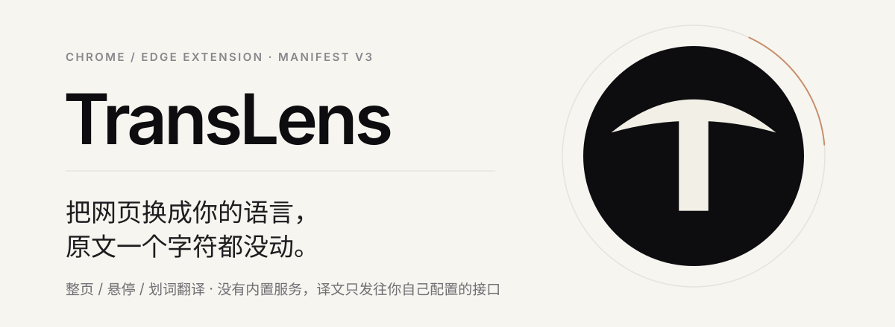
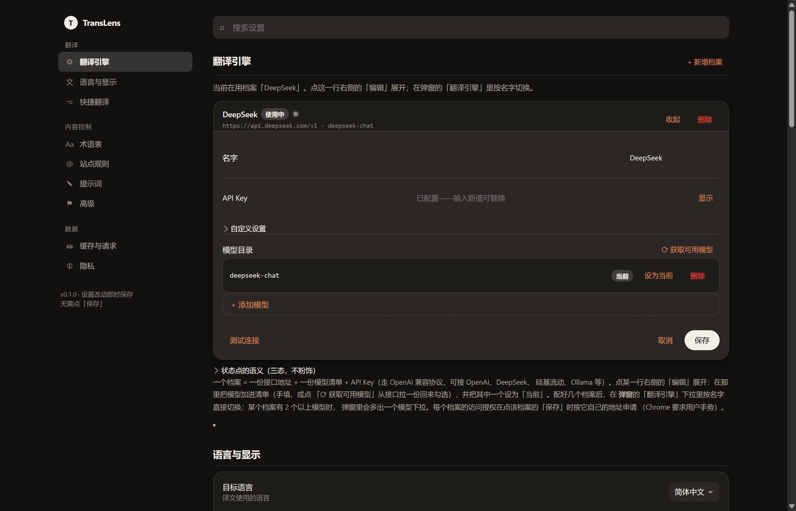
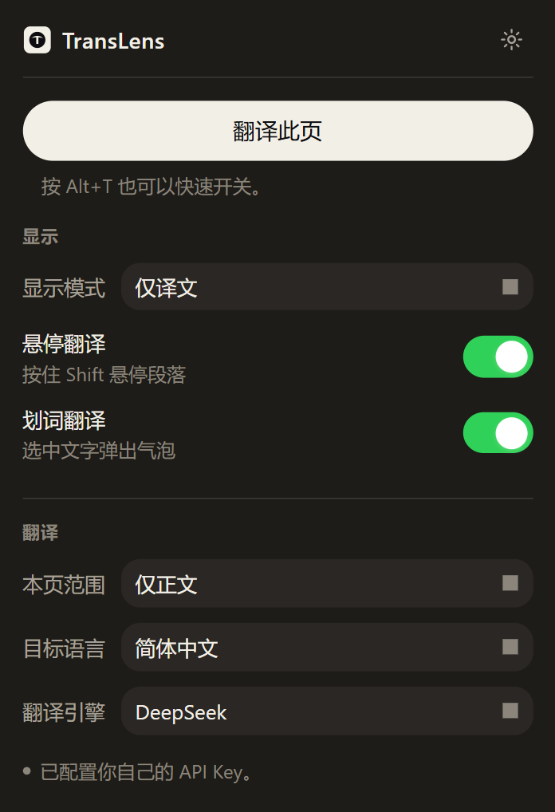

# TransLens

<p align="center">
  <picture>
    <source media="(prefers-color-scheme: dark)" srcset="assets/readme/hero-dark.svg">
    
  </picture>
</p>

<p align="center">
  <a href="https://github.com/noxiayutia/translens/actions/workflows/ci.yml"></a>
  
  
  <a href="LICENSE"></a>
</p>

Chrome / Edge 上的沉浸式网页翻译扩展（Manifest V3）。默认只显示译文，也可以在弹窗里切成双语对照；
译文只发往**你自己配置**的 OpenAI 兼容接口——扩展不预置任何引擎，也没有内置服务和中转服务器。
当前 `0.1.0`，未上架商店，装法见下。

## 装起来

**用现成的包**（不需要 Node）：从 [Releases](https://github.com/noxiayutia/translens/releases/latest)
下载 `translens-0.1.0.zip` 解压。

**自己构建**：需要 Node.js 22.22.2+ / 24.15+（`vitest` 与 `jsdom` 的硬要求，Node 20 跑不起来）。

```bash
npm install
npm run build     # 类型检查 → 打包 → 校验产物
```

然后打开 `chrome://extensions` → 开启右上角**开发者模式** → **加载已解压的扩展程序**：
方式一选解压出来的那个文件夹，方式二选本仓库的 **`dist`** 目录（注意不是仓库根目录）。

## 配上翻译引擎（装完必做）

点工具栏图标 → 右上角**齿轮** →「翻译引擎」→「+ 新增档案」：

1. 选「服务商模板」（OpenAI / DeepSeek / Ollama（本机））或直接手填**接口地址**；
2. 填 **API Key**（接本机 Ollama 时随手填个占位值即可）；
3. 在「模型目录」里加一个模型并设为「当前」；
4. 点「保存」。

回到弹窗，在「翻译引擎」里按名字选中这个档案，按 `Alt+T` 或点「翻译此页」。



> 图里是示例档案；真实使用把接口地址、模型和 Key 换成你自己的服务商即可。

## 日常怎么用

| 操作 | 效果 |
| --- | --- |
| `Alt+T` | 翻译当前页面；再按一次完全还原 |
| 右键菜单 | 翻译此页 / 翻译选中文本 |
| `Shift` + 悬停段落 | 气泡里显示该段译文（按住 `Alt` 时暂停） |
| 划词 | 先出一颗小圆点（零请求），停一下或点它才翻 |
| `Alt+Shift` + 点击段落 | 诊断模式：直接给出这段「为什么没被翻译」的结论 |
| 工具栏图标 | 弹窗：翻译此页、显示模式、悬停 / 划词开关、本页范围、目标语言、切换引擎 |
| 设置页齿轮 | 术语表、站点规则、提示词、缓存与请求、隐私 |

<p align="center"></p>

## 它是怎么翻的

- **不弄脏页面。** 译文以纯文本写进带 Shadow DOM 的宿主元素，不改原页面的 class 与结构；
  还原是把原文子节点搬回去，**逐字节复原**。
- **只翻新出现的内容。** SPA、无限滚动、展开的下拉菜单里新出现的段落单独翻译，不重发已翻过的
  （变动攒 500ms 防抖，单轮上限 60 段）。
- **限流会自己慢下来。** 开局不拉满并发，撞到 429 降一档并退避重试，这一轮末尾把被限流挤掉的
  段落补译一次。
- **设置都归你。** 术语表强制译名、站点规则指定永不翻译、提示词直接改写给模型的系统提示；
  多个服务商档案按名字切换。
- **隐私在本地。** API Key 只存在本机 `chrome.storage.local`，不进界面 DOM、不进内容脚本；
  译文缓存默认保留 30 天，可在设置页一键清除。
- **权限说得明白。** 读取所有网站的内容，才能在你打开的任意页面上做整页 / 划词 / 悬停翻译——
  安装时 Chrome 会提示「读取和更改您在所有网站上的数据」。

## 已知限制（挑要紧的）

- 几百段的大页面在真实模型下是**分钟级**，期间大片显示「翻译中…」——这是预期行为，不是卡死。
- **切到后台的标签页会明显变慢**（Chrome 会把定时器节流到每分钟一次）——翻译时保持页面可见。
- 「仅译文」模式下整页翻译进行中时悬停暂时不可用；多链接段落里的链接点不了
  （要点击请还原，或切到双语对照）。
- 改显示模式、换目标语言**不会自动重译当前页**——按 `Alt+T` 还原再翻一次，弹窗会如实提示。

完整清单与每一条的实测读数：[`docs/manual.md`](docs/manual.md#已知限制)。

## 文档

- [`docs/manual.md`](docs/manual.md) — 完整说明：功能细节、实现、**全部已知限制**
- [`docs/qa/`](docs/qa/) — 真机实测报告（代码里那些常数的依据）。写台架脚本前先读
  [measurement-traps](docs/qa/2026-09-24-measurement-traps.md)：十一个「会骗读数」的坑
- [`docs/superpowers/specs/`](docs/superpowers/specs/) — 逐项设计规格，每份都带一节「未核实的清单」

## 参与

提 issue / PR 前请先读 [`CONTRIBUTING.md`](CONTRIBUTING.md)：这个仓对断言的纪律比一般项目严一点
——每条断言都要能回答「删掉哪一行实现会让它红」。

## 许可

[MIT](LICENSE) © 2026 noxiayutia · 仓库里不包含任何翻译服务，译文都来自你自己配置的接口。
